# Convergence of the numerical settings (architecture 5.1, 5.3, 5.4, 10)

The specification asks that results converge as the timestep and the resolution are refined, that the shipped
settings sit inside the converged range, and that the documentation shows the convergence curves. This document
holds one refinement study per setting of the project's `physics` section that sets a timestep or a resolution: 4-6
levels around the shipped default (db/_templates/project.yaml), the quantities each setting acts on, the observed
order of convergence, the Richardson estimate, the shipped default's error against a documented tolerance, and the
CPU time of every level. `tools/convergence/` regenerates everything here (results, curves and the tables between
the `convergence:` markers); `tests/convergence/` re-runs each study's shipped default and finer levels and asserts
the verdicts below.

## Summary

<!-- convergence:summary:begin -->
| study | setting | shipped default | quantities inside / measured | worst default error (tolerance) | verdict |
|---|---|---|---|---|---|
| L0 stride: D10 slot (rigid) | `physics.max_deg_per_step, physics.steps_per_tooth` | deg0.5-spt96 | 8 / 9 | peak force 4.97 % (2 %) | outside for some quantities |
| L0 stride: side-milling finish (VF-2SS modes) | `physics.max_deg_per_step, physics.steps_per_tooth` | deg0.5-spt96 | 7 / 8 | peak force 9.65 % (2 %) | outside for some quantities |
| Dexel lattice: side-milling finish (rigid) | `physics.lattice_mm` | lat0.25 | 2 / 6 | removed volume 18.1 % (1 %) | outside for some quantities |
| Dexel lattice: pocket corner (rigid) | `physics.lattice_mm` | lat0.25 | 3 / 6 | removed volume 16.3 % (1 %) | outside for some quantities |
| Edge element size: D10 flat end mill, slot (rigid) | `physics.edge_element_mm` | el0.5 | 1 / 8 | chip per tooth (analytic) 5.32 % (1 %) | outside for some quantities |
| Edge element size: D10 ball nose, slot (rigid) | `physics.edge_element_mm` | el0.5 | 8 / 8 | chip per tooth (analytic) 0.561 % (1 %) | inside the converged range |
| Surface-memory bins with the stride (1-DOF, runout, regeneration) | `physics.memory_bins with physics.max_deg_per_step = 360 / memory_bins` | bins720 | 5 / 8 | peak force 10.9 % (2 %) | outside for some quantities |
| Surface-memory bins alone, stride fixed (1-DOF) | `physics.memory_bins` | bins720 | 2 / 8 | tooth-to-tooth chip spread 0.083 (0.01) | outside for some quantities |
| Surface-memory bins: chatter onset depth (1-DOF) | `physics.memory_bins` | bins720 | 1 / 1 | chatter onset depth (5 N/um) 0 % (2.5 %) | inside the converged range |
| Macro step (every domain on) | `physics.macro_ipo` | macro10 | 6 / 11 | VB growth 123 % (5 %) | outside for some quantities |
| Coupling lag (every domain on) | `physics.lag_macro` | lag1 | 6 / 6 | mean force magnitude 0 % (1.5 %) | inside the converged range |
| Workpiece thermal grid: cell size | `physics.thermal.cell_mm` | cell2 | 6 / 9 | workpiece hottest cell rise 64.1 % (1.5 %) | outside for some quantities |
| Workpiece thermal grid: cadence | `physics.thermal.every_n_macro` | every5 | 4 / 7 | workpiece hottest cell rise 20.4 % (1.5 %) | outside for some quantities |
| Turning: polar theta bins | `physics.polar_theta_bins` | th720 | 6 / 6 | mean Fx (T0) 0.00241 % (1.5 %) | inside the converged range |
| Turning: polar row height (axial resolution) | `physics.removal.polar_min_feed_mm_rev (dz = f_min / 8)` | fmin0.05 | 6 / 6 | Rt of the turned surface 1.92 % (3 %) | inside the converged range |
<!-- convergence:summary:end -->

**Inside the converged range at the shipped defaults:** every step-averaged hot-loop quantity against the L0 stride
(mean forces, torque, chip volumes, wall positions, vibration: converged from 3 deg per step on); the means against
the surface-memory bins refined with the stride, and the chatter onset depth; every turning quantity against the
polar theta bins and the row height; the wall positions (exact) and the corner's peak force against the lattice; the
ball nose's forces against the edge element size (at this depth, by alignment); the thermal expansion at the contact
against the workpiece grid's cell and cadence; `lag_macro` (2 is computed as 1: identical runs); since the fixes of
section 9 items 8 and 9, the coupled tool against the macro step (tool body, edge peak at the comparison moment, the
0.5 s means of the rake temperature cutting reads and of the preheat, the mean force at the tolerance) and against
the workpiece grid's cell and cadence (the tool's state the same to six digits at every level, the preheat within
0.5 %).

**Outside:** (1) peak forces against the stride, 5-11 % low at 0.5 deg because a peak is a step mean (within 2 %
from 0.125 deg, 2.2-2.5 times the CPU in cut); (2) the forces of a flat end mill against the edge element size, -4.8 %
at ap 3 mm, because the element at the depth-of-cut line is engaged whole or not at all (scaled by the engaged
length every size agrees to 0.05 %: a model fix, not a smaller default); (3) against the lattice, the ledger's
removed volume of a thin finishing layer (-18 % at 0.25 mm, still +2 % at 0.03125 mm: first order, not cured by
refinement), the steady peak force (+34 % at 0.25 mm), the engaged arc (oscillating +-1.3 %), the corner's mean
force (-1.8 %); (4) against the memory bins, the peak force, vibration and tooth-to-tooth chip spread, which need
the finer stride; (5) against the macro step, the values at one instant of the rake temperature and the preheat
(a step-to-step scatter of 1-2 % at every level), the workpiece's bulk rise and the edge peak's 0.5 s mean (2-6 %),
and VB growth, now below 1 um; before the fixes of section 9 items 8 and 9 the rake temperature cutting reads
depended on the step's length and the tool's wear and temperature ran away at a moment the step decided, so nothing
converged; (6) the workpiece grid's bulk, hottest-cell and contact-surface temperatures against the cell and the
cadence (before those fixes also the tool, whose runaway a 1 mm grid or a 2-step cadence brought forward). Section 8
lists the defaults the studies support and their cost; section 9 the causes found, for their owners.

## Method

**Cases.** Every case is a variant of an example project written by `cnctwin.core.drive.project_variant`
(`tools/convergence/cases.py`): the Haas VF-2SS with Al 6061-T6 and the vise of examples/pocket-islands-al6061, or
the Haas ST-20Y with a 4140 bar of examples/lathe-shaft-4140; a small block (or a meshed stock with a pocket), one
tool, a program of a few blocks, no CAD. Every setting not under study is the template default, except where a study
says otherwise (the lattice of a finishing pass at the `twin check` limit ae / 4, a fine lattice under the edge
element study, the lathe example's 0.1 mm edge elements under the turning studies). The hot-loop studies run one
operation through `cnctwin.core.drive.OperationDriver` (controller, motion, the compiled hot loop, the L2 steps of
motion, cutting, removal and dynamics; the slow domains off: a cold, unworn, rigidly held tool, dry); the
macro-step, lag and thermal studies run the whole project through `cnctwin.core.loop.Run`, the class `run_project`
runs, with every domain on.

**Quantities.** Over the ticks of the steady part of a cut (tool tip between two positions, trimmed to whole
revolutions when a revolution is a whole number of 1 ms ticks): the mean tool force and its components in T0, the
peak force (the largest L0 sample of the ticks' peak records), the mean spindle torque; over the macro steps
entirely inside: the field's removed volume and cutting's analytic chip volume per tooth pass, removal's engaged
angle, dynamics' vibration; after the cut, from the fields: wall positions (the boundary on every ray of the family
normal to the wall, 10 nm quanta), the ledger's removed volume (the z family of the tri-dexel field), the turned
profile (outer radius per theta bin and row of the polar field: Ra and Rt about a least-squares line). The
whole-loop quantities are taken at the moment the tool tip passes a fixed position in the cut (interpolated between
macro steps) or averaged over a fixed stretch of the path, so every level is compared at the same point of the same
cut.

**Observed order and Richardson estimate.** With the step sizes of the three finest levels h1 < h2 < h3 and their
values f1, f2, f3 (refinement ratios need not be equal: Celik et al. 2008, "Procedure for estimation and reporting
of uncertainty due to discretization in CFD applications", J. Fluids Eng. 130, 078001), the order p solves p =
|ln|e32 / e21| + ln((r21^p - s) / (r32^p - s))| / ln r21 with e21 = f2 - f1, e32 = f3 - f2, r21 = h2 / h1, r32 = h3
/ h2, s = sign(e32 / e21), and f_ext = (r21^p f1 - f2) / (r21^p - 1). The extrapolated value is the reference when
the convergence is monotone (s > 0) with 0.5 <= p <= 4; otherwise ("oscillating", or a fitted order outside that
range, which is a jump between levels rather than asymptotic convergence) the finest level is the reference, with
the largest difference between it and the next two levels as its uncertainty. Where the case has an exact value it
is the reference (the removed volume: the swept envelope along the path the tool actually took). Levels that agree
within a noise floor are "flat".

**Tolerances** (`tools/convergence/study.py` `TOL`): one tenth of the validation budget of the quantity
(validation/budgets.yaml), the share of the model's error budget a numerical setting may take: mean force components
and torque 1.5 % (cutting force and torque budgets 15 %), peak force 2 % (milling peak budget 20 %), tool and
workpiece temperature rises 1.5 % (tool temperature 15 %), VB growth 5 % (tool life and VB(t) 50 %), Ra and Rt 3 %
(roughness 30 %), vibration and chatter onset depth 2.5 % (wall error and stability budgets 25 %). Without a
validation budget: chip and removed volumes 1 % (half the 2 % volume-consistency band of architecture 5.4), engaged
arc 1 %, wall positions 1 um (a tenth of a +-10 um finishing tolerance), thermal expansion at the contact 0.1 um.
The shipped default is **inside the converged range** of a quantity when its error against the reference is within
the tolerance; otherwise the coarsest level from which every finer level is within it is the recommended setting.

**Cost.** Process CPU seconds of each run (`time.process_time`) through `bin/tsafe` (nice 10, one thread) on the
shared i5-4690 (other agents' jobs kept the load at 2-5: +-15 %); "CPU in cut" counts the macro steps with a tool in
the cut.

**Code.** Measured on a frozen copy of the working tree taken on 2026-11-09 at 14:28 (sources digest
5a63ec23a55df3c2, `tools/convergence/env.py --root`) with its own Numba cache; the working tree changed under other
work while the studies ran. An earlier copy (12:38) gave the same hot-loop results to the digits shown (cutting's
analytic chip volume 1-1.5 % different, from the cutting changes in between) but destroyed the tool at the first
entry of every whole-loop run (section 5). The macro-step, cell and cadence studies were measured again on
2026-11-09 evening in the `coupling` worktree with the fixes of section 9 items 8 and 9 (thermal, mechanics, and
cutting's reading of thermal; the tables of sections 5 and 6 and the summary rows are those runs; the lag table is
the earlier one). Rerunning `tools/convergence/run_all.sh` regenerates every number for the tree it is run on.

## 1. L0 stride (`physics.max_deg_per_step`, `physics.steps_per_tooth`)

The stride is the largest divisor of the IPO period (1000 base ticks on both machines) that keeps the spindle angle
per step within `max_deg_per_step`, gives at least `steps_per_tooth` steps per tooth period and resolves the modes
(architecture 5.1). At 10 000 rpm a base tick is 0.06 deg: the default 0.5 deg gives 8 us (0.48 deg, 187 steps per
tooth of the 4-flute tool), so the angle rule binds; `steps_per_tooth` = 96 binds only for tools with more than 7.5
teeth at 0.5 deg. The levels set both (4 deg / 24, 2 / 48, 1 / 96, 0.5 / 96, 0.25 / 96, 0.125 / 96, 0.0625 / 96);
with the VF-2SS modes the mode rule (2 pi f dt <= 0.3 at 2100 Hz) caps the stride at 20 us.

### 1.1 D10 slot

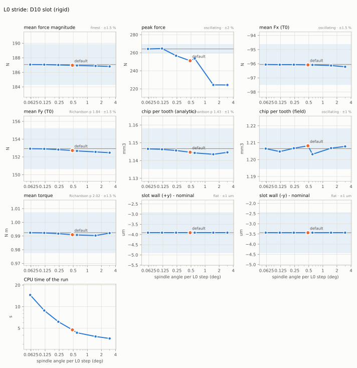

<!-- convergence:stride_slot:begin -->
Case: D10 4FL (MHSV), Al 6061-T6, 10 000 rpm, f_z 0.04 mm, full slot ap 3.0 mm, lattice 0.25 mm (default), rigid
tool and work.

| level | spindle angle per L0 step (deg) | mean force magnitude (N) | peak force (N) | mean Fx (T0) (N) | mean Fy (T0) (N) | chip per tooth (analytic) (mm3) | chip per tooth (field) (mm3) | mean torque (N m) | slot wall (+y) - nominal (um) | slot wall (-y) - nominal (um) | CPU s | in cut |
|---|---|---|---|---|---|---|---|---|---|---|---|---|
| deg4-spt24 | 3.000 | 186.8 | 224.3 | -96.22 | 152.5 | 1.145 | 1.208 | 0.9921 | -3.910 | -3.437 | 3.60 | 1.65 |
| deg2-spt48 | 1.500 | 186.9 | 224.3 | -96.13 | 152.6 | 1.144 | 1.207 | 0.9903 | -3.910 | -3.437 | 3.84 | 1.88 |
| deg1-spt96 | 0.6000 | 186.9 | 253.6 | -96.08 | 152.7 | 1.144 | 1.203 | 0.9908 | -3.910 | -3.437 | 4.33 | 2.39 |
| deg0.5-spt96 (default) | 0.4800 | 187.0 | 251.1 | -96.08 | 152.7 | 1.145 | 1.208 | 0.9910 | -3.910 | -3.437 | 4.75 | 2.78 |
| deg0.25-spt96 | 0.2400 | 187.0 | 256.7 | -96.07 | 152.8 | 1.146 | 1.207 | 0.9917 | -3.910 | -3.437 | 6.16 | 4.14 |
| deg0.125-spt96 | 0.1200 | 187.1 | 264.7 | -96.07 | 152.9 | 1.146 | 1.205 | 0.9923 | -3.910 | -3.437 | 8.83 | 6.86 |
| deg0.0625-spt96 | 0.06000 | 187.1 | 264.2 | -96.06 | 152.9 | 1.147 | 1.206 | 0.9924 | -3.910 | -3.437 | 14.5 | 12.3 |

| quantity | reference | how | observed order | default error | tolerance | default |
|---|---|---|---|---|---|---|
| mean force magnitude | 187.1 N | finest level | (2.19) | 0.0532 % | 1.5 % | inside |
| peak force | 264.2 N | finest (oscillating) | (4.14) | 4.97 % | 2 % | outside: use 0.12 |
| mean Fx (T0) | -96.06 N | finest (oscillating) | (2.10) | 0.0238 % | 1.5 % | inside |
| mean Fy (T0) | 152.9 N | Richardson (3 finest) | 1.84 | 0.137 % | 1.5 % | inside |
| chip per tooth (analytic) | 1.147 mm3 | Richardson (3 finest) | 1.43 | 0.176 % | 1 % | inside |
| chip per tooth (field) | 1.206 mm3 | finest (oscillating) | (0.172) | 0.138 % | 1 % | inside |
| mean torque | 0.9924 N m | Richardson (3 finest) | 2.02 | 0.148 % | 1.5 % | inside |
| slot wall (+y) - nominal | -3.910 um | all levels agree | - | 0.000182 um | 1 um | inside |
| slot wall (-y) - nominal | -3.437 um | all levels agree | - | 0.000136 um | 1 um | inside |

Observed orders in parentheses are those of the three finest levels where they are not used (not monotone, or
outside 0.5-4). "in cut": CPU seconds of the macro steps with the tool in the cut.
<!-- convergence:stride_slot:end -->

The step-integrated quantities converge from the coarsest level on: mean force, components, torque and both chip
volumes change by less than 0.2 % between 3 deg and 0.06 deg per step (orders 1.4-2.2), because cutting integrates
each element's force in closed form over the angle it sweeps in a step (cnctwin/cutting, section 4). The slot walls,
cut by removal at the slabs' generation instants, agree to 0.3 nm (the 3.4 / 3.9 um below nominal are the machine's
geometric and servo errors, the same at every level). The **peak force is outside**: it is the largest step sample,
i.e. the step mean of a force that jumps whenever an element enters the cut (its edge force); at 0.48 deg it is 5.0
% below the peak of 0.12 / 0.06 deg (264 N, the two agree to 0.2 %), and the levels in between do not converge
monotonically (the jumps fall at different places within a step). The peak is within 2 % from 0.12 deg.

### 1.2 Side-milling finish with the machine's modes

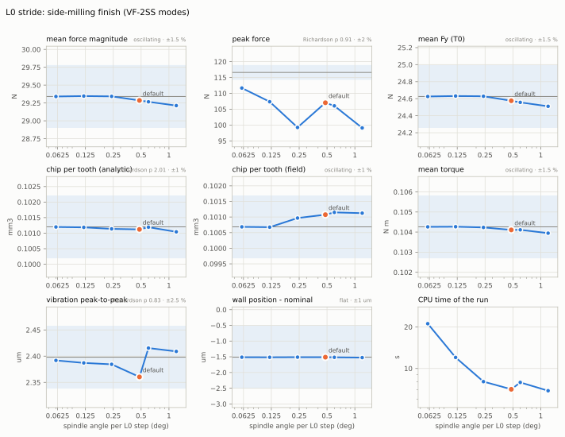

<!-- convergence:stride_side:begin -->
Case: D10 4FL, Al 6061-T6, 10 000 rpm, f_z 0.04 mm, climb, ae 0.5 mm, ap 5 mm, lattice 0.125 mm (= ae / 4, the twin
check rule), the VF-2SS machine's modes in the hot loop (dynamics L2 off).

| level | spindle angle per L0 step (deg) | mean force magnitude (N) | peak force (N) | mean Fy (T0) (N) | chip per tooth (analytic) (mm3) | chip per tooth (field) (mm3) | mean torque (N m) | vibration peak-to-peak (um) | wall position - nominal (um) | CPU s | in cut |
|---|---|---|---|---|---|---|---|---|---|---|---|
| deg2-spt48 | 1.200 | 28.56 | 89.72 | 23.96 | 0.09884 | 0.1003 | 0.1017 | 2.381 | -1.576 | 4.96 | 2.36 |
| deg1-spt96 | 0.6000 | 28.59 | 96.08 | 23.99 | 0.09878 | 0.1001 | 0.1017 | 2.362 | -1.574 | 5.42 | 2.79 |
| deg0.5-spt96 (default) | 0.4800 | 28.62 | 97.35 | 24.02 | 0.09895 | 0.1002 | 0.1018 | 2.375 | -1.562 | 5.83 | 3.02 |
| deg0.25-spt96 | 0.2400 | 28.68 | 98.62 | 24.07 | 0.09900 | 0.1001 | 0.1020 | 2.366 | -1.572 | 6.96 | 4.13 |
| deg0.125-spt96 | 0.1200 | 28.68 | 107.6 | 24.07 | 0.09901 | 0.1001 | 0.1019 | 2.375 | -1.571 | 9.79 | 6.46 |
| deg0.0625-spt96 | 0.06000 | 28.67 | 107.7 | 24.06 | 0.09900 | 0.09998 | 0.1019 | 2.376 | -1.567 | 15.0 | 10.9 |

| quantity | reference | how | observed order | default error | tolerance | default |
|---|---|---|---|---|---|---|
| mean force magnitude | 28.66 N | Richardson (3 finest) | 0.640 | 0.111 % | 1.5 % | inside |
| peak force | 107.7 N | finest level | (5.57) | 9.65 % | 2 % | outside: use 0.12 |
| mean Fy (T0) | 24.05 N | Richardson (3 finest) | 0.597 | 0.109 % | 1.5 % | inside |
| chip per tooth (analytic) | 0.09900 mm3 | finest (oscillating) | (0.623) | 0.0543 % | 1 % | inside |
| chip per tooth (field) | 0.09998 mm3 | finest level | (12.7) | 0.242 % | 1 % | inside |
| mean torque | 0.1019 N m | finest level | (0.191) | 0.107 % | 1.5 % | inside |
| vibration peak-to-peak | 2.376 um | Richardson (3 finest) | 3.20 | 0.053 % | 2.5 % | inside |
| wall position - nominal | -1.567 um | all levels agree | - | 0.00557 um | 1 um | inside |

Observed orders in parentheses are those of the three finest levels where they are not used (not monotone, or
outside 0.5-4). "in cut": CPU seconds of the macro steps with the tool in the cut.
<!-- convergence:stride_side:end -->

With the VF-2SS modes in the loop (spindle 950 / 2100 Hz, column, table) the same holds for a finish in climb
milling, where every element enters at its largest chip: the means, the vibration (2.38 um peak to peak) and the
wall position (1.57 um below nominal, of which the deflection is the part above the slot's machine error) are
converged at every level, to 0.3 % and 0.01 um; the peak force is 9.6 % below the 0.12 / 0.06 deg value (107.7 N) at
the default and reaches it only at 0.12 deg. The shipped stride is inside the converged range for every averaged
quantity and outside it for the peak force; 0.125 deg (a 2 us stride at 10 000 rpm) puts the peak inside at 2.2-2.5
times the CPU in cut (2.8 -> 6.9 s in the slot, 3.0 -> 6.5 s in the finish).

## 2. Dexel lattice (`physics.lattice_mm`)

The tri-dexel lattice (removal, section 1) is the spacing of the rays that carry the workpiece; the boundary
positions on a ray are exact to the 10 nm quantum, so a lattice error is a sampling error across the rays. Both
cases are finishing passes 0.3 mm into a wall (ae is not a multiple of any level's spacing, so the levels sample the
layer differently), rigid (the deflection would mix the forces into the wall position). `twin check` requires
lattice_mm <= ae / 4 = 0.075 mm here (or a refine box): the template's 0.25 mm is the default a project gets, and
0.0625 mm is the first level the check admits. The **removed volume** is the ledger's: the z family's exact integer
sum (architecture 5.4, 10); its reference is the volume the tool's envelope sweeps along the path the tool actually
took (the side wall: the y family, which crosses that wall and is exact on every ray; the corner: the envelope swept
along the 1 ms tool positions, `swept_wall_volume`, because the control rounds the corner by up to 0.45 mm and the
machine's errors offset the walls by 3-5 um; measured on the commanded and actual tip paths, the tree of these
tables passed the corner at 0.635 / 0.646 mm, since the fix of section 9 item 11 at 0.181 / 0.193 mm).

### 2.1 Side-milling finish

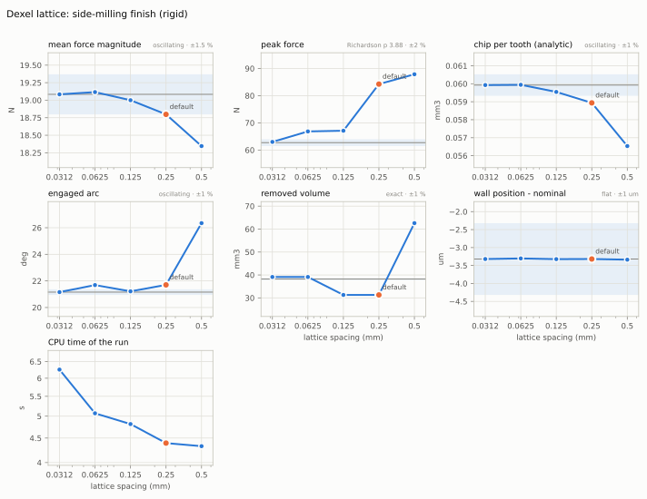

<!-- convergence:lattice_side:begin -->
Case: D10 4FL, Al 6061-T6, 10 000 rpm, f_z 0.04 mm, climb, ae 0.3 mm, ap 5 mm, rigid; the template default 0.25 mm
is above the twin check limit ae / 4 = 0.075 mm for this pass.

| level | lattice spacing (mm) | mean force magnitude (N) | peak force (N) | chip per tooth (analytic) (mm3) | engaged arc (deg) | removed volume (mm3) | wall position - nominal (um) | CPU s | in cut |
|---|---|---|---|---|---|---|---|---|---|
| lat0.5 | 0.5000 | 18.35 | 87.85 | 0.05653 | 26.35 | 62.59 | -3.338 | 4.33 | 2.16 |
| lat0.25 (default) | 0.2500 | 18.80 | 84.24 | 0.05894 | 21.70 | 31.29 | -3.319 | 4.39 | 2.15 |
| lat0.125 | 0.1250 | 19.00 | 67.10 | 0.05955 | 21.22 | 31.29 | -3.323 | 4.81 | 2.28 |
| lat0.0625 | 0.06250 | 19.12 | 66.84 | 0.05994 | 21.69 | 39.12 | -3.304 | 5.07 | 2.53 |
| lat0.03125 | 0.03125 | 19.08 | 62.99 | 0.05993 | 21.16 | 39.12 | -3.320 | 6.25 | 3.32 |

| quantity | reference | how | observed order | default error | tolerance | default |
|---|---|---|---|---|---|---|
| mean force magnitude | 19.08 N | finest (oscillating) | (1.85) | 1.5 % | 1.5 % | inside |
| peak force | 62.71 N | Richardson (3 finest) | 3.88 | 34.2 % | 2 % | outside: use 0.03125 |
| chip per tooth (analytic) | 0.05993 mm3 | finest (oscillating) | (4.77) | 1.65 % | 1 % | outside: use 0.125 |
| engaged arc | 21.16 deg | finest (oscillating) | (0.168) | 2.57 % | 1 % | outside: no measured level converged |
| removed volume | 38.22 mm3 | exact | (17.9) | 18.1 % | 1 % | outside: no measured level converged |
| wall position - nominal | -3.320 um | all levels agree | - | 0.00091 um | 1 um | inside |

Observed orders in parentheses are those of the three finest levels where they are not used (not monotone, or
outside 0.5-4). "in cut": CPU seconds of the macro steps with the tool in the cut.
<!-- convergence:lattice_side:end -->

The wall position is exact at every level (the y rays end on the wall to the quantum). The ledger's removed volume
is not: the z columns stand at lattice nodes, so a layer 0.3 mm thick holds a whole number of node rows, and the
volume is that number times the spacing (62.6 mm3 at 0.5 mm, 31.3 at 0.25 and 0.125, 39.1 at 0.0625 and 0.03125
against 38.2): -18 % at the default and +2.3 % even at 0.03125 mm. The error is first order in the spacing, bounded
by a / (2 ae), and depends on where the wall falls between nodes, so refinement alone does not bring it within 1 %;
the x and y families estimate the same material (removal publishes the three as `removed_volume_xyz_m3`), and the
family normal to the cut surface is exact for it. The forces converge at about first order (the mean is 1.50 % low
at the default, at the tolerance, and 1.59 % on the working tree of 16:00, so it counts as outside; 0.17 % at 0.0625
mm); the peak force is 34 % high at the default (84 against 63 N) and still moving at 0.03125 mm; cutting's analytic
chip volume is 1.7 % low at the default and inside from 0.125 mm; the engaged arc oscillates by +-1.3 % between
neighbouring levels at every spacing up to 0.25 mm, so its reference is uncertain by more than the 1 % tolerance
(the cause was not isolated).

### 2.2 Pocket corner

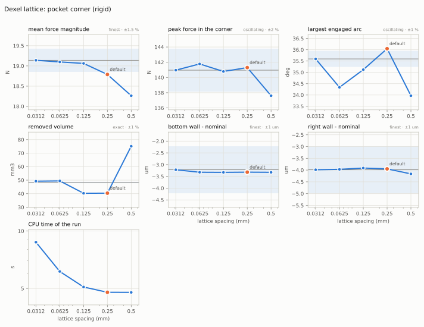

<!-- convergence:lattice_corner:begin -->
Case: meshed stock with a channel (walls at y = 5 and x = 30 mm), D10 4FL climb finishing 0.3 mm into both walls
through the internal corner, ap 5 mm, 10 000 rpm, f_z 0.04 mm, rigid.

| level | lattice spacing (mm) | mean force magnitude (N) | peak force in the corner (N) | largest engaged arc (deg) | removed volume (mm3) | bottom wall - nominal (um) | right wall - nominal (um) | CPU s | in cut |
|---|---|---|---|---|---|---|---|---|---|
| lat0.5 | 0.5000 | 18.26 | 137.6 | 33.97 | 75.11 | -3.327 | -4.162 | 4.77 | 2.77 |
| lat0.25 (default) | 0.2500 | 18.79 | 141.3 | 36.05 | 40.37 | -3.320 | -3.948 | 4.77 | 2.80 |
| lat0.125 | 0.1250 | 19.06 | 140.8 | 35.12 | 40.29 | -3.329 | -3.913 | 5.09 | 3.02 |
| lat0.0625 | 0.06250 | 19.10 | 141.8 | 34.34 | 49.43 | -3.324 | -3.969 | 6.14 | 3.64 |
| lat0.03125 | 0.03125 | 19.14 | 141.0 | 35.59 | 49.22 | -3.218 | -3.985 | 8.73 | 5.09 |

| quantity | reference | how | observed order | default error | tolerance | default |
|---|---|---|---|---|---|---|
| mean force magnitude | 19.14 N | finest level | (0.155) | 1.83 % | 1.5 % | outside: use 0.125 |
| peak force in the corner | 141.0 N | finest (oscillating) | (0.272) | 0.242 % | 2 % | inside |
| largest engaged arc | 35.59 deg | finest (oscillating) | (0.685) | 1.27 % | 1 % | outside: no measured level converged |
| removed volume | 48.25 mm3 | exact | (5.44) | 16.3 % | 1 % | outside: no measured level converged |
| bottom wall - nominal | -3.218 um | finest level | (4.40) | 0.103 um | 1 um | inside |
| right wall - nominal | -3.985 um | finest level | (1.75) | 0.037 um | 1 um | inside |

Observed orders in parentheses are those of the three finest levels where they are not used (not monotone, or
outside 0.5-4). "in cut": CPU seconds of the macro steps with the tool in the cut.
<!-- convergence:lattice_corner:end -->

The corner shows the same pattern: walls exact, the ledger volume -16 % at the default and +2.0 % at 0.03125 mm
against the swept volume (48.25 mm3; the y family is within 0.15 % of it at 0.03125 mm), the mean force 1.8 % low at
the default (inside from 0.125 mm), the largest engaged arc oscillating by +-2 %. The peak force in the corner (141
N, the largest load of the pass) is within 0.6 % at every level from 0.25 mm: the corner's load is set by the
engagement the path gives, which the gating finds on plane walls exactly; the peak along the steady wall is the
quantity the lattice moves (+30 % at 0.25 mm, as in 2.1; not isolated: the refill of stale memory bins from the
field near the stock's edge is the likely path).

## 3. Edge element size (`physics.edge_element_mm`)

Tooling discretises every cutting edge into elements of at most `edge_element_mm` of arc length, and at most 5 deg
of helix lag (`physics.tooling.max_lag_step_deg`) or 7.5 deg of edge-normal turn (`max_kappa_step_deg`) each
(cnctwin/tooling/edges.py `discretise`). On the D10 helical end mill (35 deg) the lag rule binds above 0.76 mm of
arc and on the D10 ball above 0.65 mm, so 1 mm and 2 mm give the same edge: the coarsest level is 1 mm (the
lag-limited edge). Both cases are slots on a 0.0625 mm lattice, rigid.

### 3.1 Flat end mill

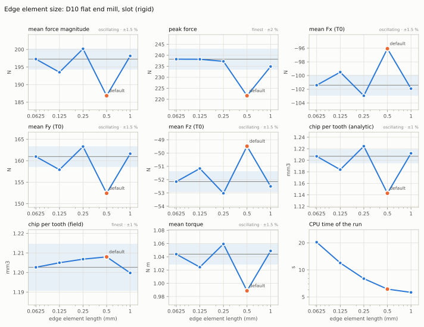

<!-- convergence:element_flat:begin -->
Case: D10 4FL (MHSV), Al 6061-T6, 10 000 rpm, f_z 0.04 mm, full slot ap 3.0 mm, lattice 0.0625 mm, rigid.

| level | edge element length (mm) | mean force magnitude (N) | peak force (N) | mean Fx (T0) (N) | mean Fy (T0) (N) | mean Fz (T0) (N) | chip per tooth (analytic) (mm3) | chip per tooth (field) (mm3) | mean torque (N m) | CPU s | in cut |
|---|---|---|---|---|---|---|---|---|---|---|---|
| el1 | 1.000 | 198.2 | 234.9 | -101.9 | 161.6 | -52.50 | 1.212 | 1.200 | 1.049 | 5.61 | 3.45 |
| el0.5 (default) | 0.5000 | 186.8 | 221.6 | -96.08 | 152.4 | -49.49 | 1.143 | 1.208 | 0.9887 | 6.10 | 3.93 |
| el0.25 | 0.2500 | 200.2 | 237.2 | -102.9 | 163.3 | -53.02 | 1.224 | 1.207 | 1.059 | 7.98 | 5.55 |
| el0.125 | 0.1250 | 193.5 | 238.2 | -99.50 | 157.9 | -51.16 | 1.184 | 1.205 | 1.024 | 11.9 | 9.51 |
| el0.0625 | 0.06250 | 197.3 | 238.2 | -101.4 | 161.0 | -52.15 | 1.207 | 1.203 | 1.044 | 20.3 | 17.1 |

| quantity | reference | how | observed order | default error | tolerance | default |
|---|---|---|---|---|---|---|
| mean force magnitude | 197.3 N | finest (oscillating) | (0.834) | 5.28 % | 1.5 % | outside: no measured level converged |
| peak force | 238.2 N | finest level | (4.61) | 6.97 % | 2 % | outside: use 0.25 |
| mean Fx (T0) | -101.4 N | finest (oscillating) | (0.851) | 5.26 % | 1.5 % | outside: no measured level converged |
| mean Fy (T0) | 161.0 N | finest (oscillating) | (0.818) | 5.31 % | 1.5 % | outside: no measured level converged |
| mean Fz (T0) | -52.15 N | finest (oscillating) | (0.914) | 5.11 % | 1.5 % | outside: no measured level converged |
| chip per tooth (analytic) | 1.207 mm3 | finest (oscillating) | (0.809) | 5.32 % | 1 % | outside: no measured level converged |
| chip per tooth (field) | 1.203 mm3 | finest level | (0.363) | 0.443 % | 1 % | inside |
| mean torque | 1.044 N m | finest (oscillating) | (0.833) | 5.3 % | 1.5 % | outside: no measured level converged |

Observed orders in parentheses are those of the three finest levels where they are not used (not monotone, or
outside 0.5-4). "in cut": CPU seconds of the macro steps with the tool in the cut.
<!-- convergence:element_flat:end -->

### 3.2 Ball nose

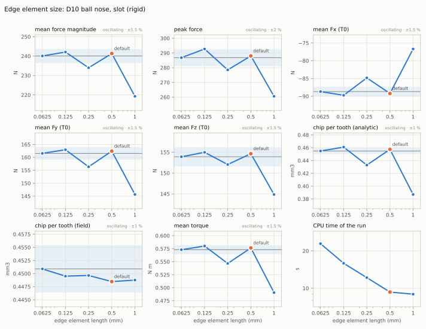

<!-- convergence:element_ball:begin -->
Case: D10 4FL ball nose (Tungaloy TEB100E4L), Al 6061-T6, 10 000 rpm, f_z 0.04 mm, slot ap 2.0 mm (the ball only),
lattice 0.0625 mm, rigid.

| level | edge element length (mm) | mean force magnitude (N) | peak force (N) | mean Fx (T0) (N) | mean Fy (T0) (N) | mean Fz (T0) (N) | chip per tooth (analytic) (mm3) | chip per tooth (field) (mm3) | mean torque (N m) | CPU s | in cut |
|---|---|---|---|---|---|---|---|---|---|---|---|
| el1 | 1.000 | 219.3 | 260.5 | -76.69 | 145.7 | 144.9 | 0.3870 | 0.4488 | 0.4906 | 8.95 | 4.96 |
| el0.5 (default) | 0.5000 | 241.3 | 288.0 | -89.21 | 162.4 | 154.6 | 0.4574 | 0.4485 | 0.5764 | 9.31 | 5.29 |
| el0.25 | 0.2500 | 234.0 | 278.5 | -84.82 | 156.3 | 152.0 | 0.4329 | 0.4496 | 0.5466 | 12.2 | 7.65 |
| el0.125 | 0.1250 | 242.1 | 292.7 | -89.72 | 162.9 | 155.0 | 0.4609 | 0.4495 | 0.5801 | 15.9 | 11.3 |
| el0.0625 | 0.06250 | 240.1 | 286.8 | -88.68 | 161.5 | 153.9 | 0.4549 | 0.4509 | 0.5730 | 22.8 | 17.4 |

| quantity | reference | how | observed order | default error | tolerance | default |
|---|---|---|---|---|---|---|
| mean force magnitude | 240.1 N | finest (oscillating) | (2.01) | 0.523 % | 1.5 % | inside (reference uncertain) |
| peak force | 286.8 N | finest (oscillating) | (1.26) | 0.419 % | 2 % | inside (reference uncertain) |
| mean Fx (T0) | -88.68 N | finest (oscillating) | (2.23) | 0.6 % | 1.5 % | inside (reference uncertain) |
| mean Fy (T0) | 161.5 N | finest (oscillating) | (2.22) | 0.541 % | 1.5 % | inside (reference uncertain) |
| mean Fz (T0) | 153.9 N | finest (oscillating) | (1.46) | 0.477 % | 1.5 % | inside |
| chip per tooth (analytic) | 0.4549 mm3 | finest (oscillating) | (2.21) | 0.561 % | 1 % | inside (reference uncertain) |
| chip per tooth (field) | 0.4509 mm3 | finest (oscillating) | (3.39) | 0.536 % | 1 % | inside |
| mean torque | 0.5730 N m | finest (oscillating) | (2.23) | 0.597 % | 1.5 % | inside (reference uncertain) |

Observed orders in parentheses are those of the three finest levels where they are not used (not monotone, or
outside 0.5-4). "in cut": CPU seconds of the macro steps with the tool in the cut.
<!-- convergence:element_ball:end -->

**Flat end mill: outside, and the reason is one element.** The forces, the torque and cutting's analytic chip volume
jump between levels (198.2, 186.8, 200.2, 193.5, 197.3 N from 1 to 0.0625 mm) instead of converging. The edge
stations around the depth of cut (recorded with each level) explain all of it: an element is engaged whole or not at
all, so the engaged edge ends at the boundary of the top engaged element, not at the stock's top. At 0.5 mm the top
engaged station is at 2.65 mm and the next at 3.06 mm, so the engaged edge reaches 2.86 mm of the 3 mm cut (-4.8 %);
at 0.25 mm it reaches 3.06 mm (+2.0 %), at 0.125 mm 2.96 mm (-1.4 %), at 0.0625 mm 3.02 mm (+0.6 %). Scaled by ap
over the engaged length, every level gives the same force, 196.18 N (to 0.05 %), the same torque and chip volume
(1.2000 mm3, 0.2 % from the field's): the element size changes nothing else. The error is (engaged length - ap) /
ap, bounded by half an element's axial height over ap (0.20 mm / ap at the default: 6.8 % at ap 3 mm, 20 % at ap 1
mm, 34 % at ap 0.6 mm, the depth of section 4.1), and refinement only narrows the bound (0.025 mm / ap at 0.0625 mm,
4.4 times the CPU in cut). The field's removed volume per tooth does not depend on the element size (the field
removes the swept envelope). **Ball nose: inside, by alignment.** At ap 2 mm the default happens to end its engaged
arc 1.7 % above the top (forces within 0.6 % of the finest level), but the 0.25 mm level is 2.5 % low and the levels
oscillate by more than the tolerance, so the verdict holds for this depth only; the same element boundary rule
applies.

## 4. Surface-memory bins (`physics.memory_bins`)

The surface memory holds, per edge station and angle bin of T0, the point the last effective edge passage left
(architecture 5.4, cutting section 3); the chip thickness is the element's position against the memory interpolated
between the two bins around its angle. The cases are a full slot 0.6 mm deep with 5 um runout on a VF-2SS whose only
flexible mode is a spindle mode in x (900 Hz, zeta 0.02, 5 N/um): stable, with 10 um of forced vibration imprinted
on the surface each tooth reads (regeneration), and the 1-DOF chatter onset. An element's chip is evaluated once per
L0 step (at the centroid of the angle it sweeps), so a bin narrower than the angle of a step is written from the
step's first-order motion: the memory is refined together with the stride (4.1, at most one bin per step:
max_deg_per_step = 360 / memory_bins) and, to show the interplay, alone (4.2).

### 4.1 Forces with runout and regeneration: the bins with the stride

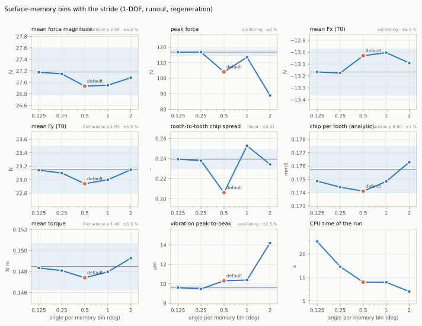

<!-- convergence:bins_stride:begin -->
Case: the case of bins_runout with the L0 stride refined with the bins (at most one memory bin per L0 step:
max_deg_per_step = 360 / memory_bins; steps_per_tooth 24 so that the angle rule binds).

| level | angle per memory bin (deg) | mean force magnitude (N) | peak force (N) | mean Fx (T0) (N) | mean Fy (T0) (N) | tooth-to-tooth chip spread (-) | chip per tooth (analytic) (mm3) | mean torque (N m) | vibration peak-to-peak (um) | CPU s | in cut |
|---|---|---|---|---|---|---|---|---|---|---|---|
| bins180 | 2.000 | 27.08 | 88.91 | -13.09 | 23.15 | 0.2343 | 0.1763 | 0.1493 | 14.20 | 6.61 | 4.56 |
| bins360 | 1.000 | 26.95 | 113.5 | -13.00 | 23.00 | 0.2527 | 0.1748 | 0.1480 | 10.39 | 8.69 | 6.60 |
| bins720 (default) | 0.5000 | 26.94 | 104.1 | -13.03 | 22.94 | 0.2060 | 0.1741 | 0.1474 | 10.31 | 8.72 | 6.75 |
| bins1440 | 0.2500 | 27.15 | 116.8 | -13.18 | 23.10 | 0.2380 | 0.1744 | 0.1481 | 9.472 | 13.8 | 11.8 |
| bins2880 | 0.1250 | 27.18 | 116.8 | -13.17 | 23.14 | 0.2394 | 0.1749 | 0.1483 | 9.609 | 29.2 | 27.1 |

| quantity | reference | how | observed order | default error | tolerance | default |
|---|---|---|---|---|---|---|
| mean force magnitude | 27.18 N | Richardson (3 finest) | 2.90 | 0.906 % | 1.5 % | inside |
| peak force | 116.8 N | finest (oscillating) | (8.24) | 10.9 % | 2 % | outside: use 0.25 |
| mean Fx (T0) | -13.17 N | finest (oscillating) | (4.05) | 1.04 % | 1.5 % | inside |
| mean Fy (T0) | 23.16 N | Richardson (3 finest) | 1.93 | 0.93 % | 1.5 % | inside |
| tooth-to-tooth chip spread | 0.2394 - | finest level | (4.52) | 0.0333 - | 0.01 - | outside: use 0.25 |
| chip per tooth (analytic) | 0.1758 mm3 | Richardson (3 finest) | 0.596 | 0.941 % | 1 % | inside |
| mean torque | 0.1485 N m | Richardson (3 finest) | 1.46 | 0.725 % | 1.5 % | inside |
| vibration peak-to-peak | 9.609 um | finest (oscillating) | (2.61) | 7.32 % | 2.5 % | outside: use 0.25 |

Observed orders in parentheses are those of the three finest levels where they are not used (not monotone, or
outside 0.5-4). "in cut": CPU seconds of the macro steps with the tool in the cut.
<!-- convergence:bins_stride:end -->

### 4.2 The bins alone

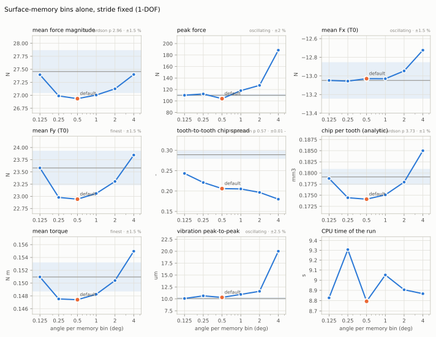

<!-- convergence:bins_runout:begin -->
Case: D10 4FL, Al 6061-T6, 10 000 rpm, f_z 0.04 mm, full slot ap 0.6 mm, runout 5 um TIR, the VF-2SS with one
spindle mode in x (900 Hz, zeta 0.02, 5 N/um; stable: forced vibration imprinted on the surface).

| level | angle per memory bin (deg) | mean force magnitude (N) | peak force (N) | mean Fx (T0) (N) | mean Fy (T0) (N) | tooth-to-tooth chip spread (-) | chip per tooth (analytic) (mm3) | mean torque (N m) | vibration peak-to-peak (um) | CPU s | in cut |
|---|---|---|---|---|---|---|---|---|---|---|---|
| bins90 | 4.000 | 27.40 | 188.5 | -12.72 | 23.85 | 0.1801 | 0.1850 | 0.1550 | 20.01 | 8.87 | 6.84 |
| bins180 | 2.000 | 27.12 | 127.2 | -12.95 | 23.30 | 0.1967 | 0.1779 | 0.1504 | 11.59 | 8.91 | 6.96 |
| bins360 | 1.000 | 27.00 | 118.1 | -13.03 | 23.06 | 0.2052 | 0.1751 | 0.1483 | 10.94 | 9.05 | 7.04 |
| bins720 (default) | 0.5000 | 26.94 | 104.1 | -13.03 | 22.94 | 0.2060 | 0.1741 | 0.1474 | 10.31 | 8.79 | 6.78 |
| bins1440 | 0.2500 | 26.99 | 112.3 | -13.06 | 22.98 | 0.2210 | 0.1744 | 0.1475 | 10.64 | 9.31 | 7.15 |
| bins2880 | 0.1250 | 27.40 | 110.0 | -13.05 | 23.58 | 0.2432 | 0.1788 | 0.1510 | 10.08 | 8.83 | 6.89 |

| quantity | reference | how | observed order | default error | tolerance | default |
|---|---|---|---|---|---|---|
| mean force magnitude | 27.46 N | Richardson (3 finest) | 2.96 | 1.9 % | 1.5 % | outside: use 0.125 |
| peak force | 110.0 N | finest (oscillating) | (1.86) | 5.38 % | 2 % | outside: no measured level converged |
| mean Fx (T0) | -13.05 N | finest (oscillating) | (1.80) | 0.144 % | 1.5 % | inside |
| mean Fy (T0) | 23.58 N | finest level | (4.06) | 2.72 % | 1.5 % | outside: no measured level converged |
| tooth-to-tooth chip spread | 0.2890 - | Richardson (3 finest) | 0.571 | 0.083 - | 0.01 - | outside: no measured level converged |
| chip per tooth (analytic) | 0.1791 mm3 | Richardson (3 finest) | 3.73 | 2.8 % | 1 % | outside: use 0.125 |
| mean torque | 0.1510 N m | finest level | (4.86) | 2.35 % | 1.5 % | outside: no measured level converged |
| vibration peak-to-peak | 10.08 um | finest (oscillating) | (0.774) | 2.32 % | 2.5 % | inside (reference uncertain) |

Observed orders in parentheses are those of the three finest levels where they are not used (not monotone, or
outside 0.5-4). "in cut": CPU seconds of the macro steps with the tool in the cut.
<!-- convergence:bins_runout:end -->

### 4.3 Chatter onset depth of a 1-DOF system

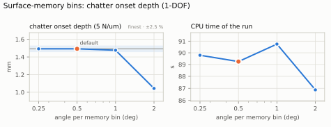

<!-- convergence:bins_chatter:begin -->
Case: full slot, D10 4FL, Al 6061-T6, 10 000 rpm, f_z 0.04 mm, ap 2.4 mm; one spindle mode in x (900 Hz, zeta 0.02);
onset by bisection over the modal stiffness, reported as the onset depth at 5 N/um.

| level | angle per memory bin (deg) | chatter onset depth (5 N/um) (mm) | CPU s | in cut |
|---|---|---|---|---|
| bins180 | 2.000 | 1.044 | 86.9 | 68.8 |
| bins360 | 1.000 | 1.476 | 90.7 | 72.4 |
| bins720 (default) | 0.5000 | 1.492 | 89.2 | 70.7 |
| bins1440 | 0.2500 | 1.492 | 89.8 | 70.6 |

| quantity | reference | how | observed order | default error | tolerance | default |
|---|---|---|---|---|---|---|
| chatter onset depth (5 N/um) | 1.492 mm | finest level | - | 0 % | 2.5 % | inside |

Observed orders in parentheses are those of the three finest levels where they are not used (not monotone, or
outside 0.5-4). "in cut": CPU seconds of the macro steps with the tool in the cut.
<!-- convergence:bins_chatter:end -->

**With the stride (4.1): inside for the averages, outside where the stride is.** Mean force, its components, torque
and the analytic chip volume are within 0.9 % of the Richardson value at the default (720 bins, 0.48 deg per step);
the peak force (-10.9 %), the peak-to-peak vibration (+7.3 %) and the spread of the mean chip between the four teeth
(0.206 against 0.239; runout and the variable pitch) are not, and they are the quantities of section 1 that need a
finer stride: in this regenerative case the vibration and the per-tooth chips move with it too (in the finish of
section 1.2, with the stiff VF-2SS modes, the vibration did not). At 180 bins (2 deg per bin and step) the vibration
is 14 um instead of 9.6. **The bins alone (4.2)** at the default stride agree within 0.3 % from 360 to 1440 bins for
the mean force, but 2880 bins (3.8 bins per step) moves it by +1.5 % and the chip volume by +2.5 %, away from the
joint refinement's values (+0.8 % and +1.4 % from its 2880-bin level): the memory must not be finer than the angle
of an L0 step (memory_bins <= 360 / (angle per step)); the shipped pair (720 bins, 0.5 deg) sits exactly at that
limit. At 90 bins (8 steps per bin) the vibration doubles. **Chatter onset (4.3)**: bisection over the modal
stiffness at ap 2.4 mm (seven halvings in log k between 4 and 16 N/um: the onset known to +-0.55 %), reported as the
onset depth of the 5 N/um system, ap 5 / k_onset (the limit depth of a linear regenerative system is proportional to
k; a bisection over ap would snap to the edge stations, section 3). 720 and 1440 bins give the same bracket
(1.484-1.500 mm), 360 bins 1.1 % less; at 180 bins the coarse memory puts non-harmonic content into the stable
vibration (chatter index 0.31 at 16 N/um, against 0.008 at 720 bins) and the detected onset falls to 1.04 mm (-30
%). Inside the converged range at the default.

## 5. Macro step and coupling lag (`physics.macro_ipo`, `physics.lag_macro`)

`macro_ipo` is the number of 1 ms IPO ticks per macro step: the period at which the hot loop's frozen inputs are
rebuilt and the slow domains (cutting's coefficient rows from the tool temperatures, wear and the coolant's
friction, thermal, wear, coolant, chips, holding, structure, surface) exchange their records (architecture 5.1,
5.3); the cadences `every_n_macro` are counted in macro steps (thermal's finite volumes every 5, structure's refresh
every 50 with a latency of 50, coolant every step in the template), so they scale with it. `lag_macro: 2` is
accepted by the schema but computed as lag 1 (cnctwin/core/loop.py; docs/models/loop.md "Open problems"): the
ledger's alignment window is the only thing it changes. Case: a side step 0.5 mm wide and 1 mm deep along the 150 mm
front face of a 150 x 20 x 15 mm block of Al 6061-T6 in the pocket example's vise, D10 4-flute at 10 000 rpm, f_z
0.04 mm, flood coolant, from x = -8 to 110 mm: 4.4 s in cut, 9.9 s simulated with the tool change and the approach.
Structure's work model is capped at 3000 DOF (its 50 000 DOF default cost about 1 s per macro step on this stock;
0.72 s measured, 0.09 s since 2026-11-09 with the set-up and 0.02 s amortised: docs/performance.md 11);
dynamics' lobe diagrams run on coarse grids (they feed nothing here). The quantities are taken when the tool tip
passes x = 100 mm (about 3.6 s into the cut), the forces over x = 20-100 mm, the energy balance residual over the
run. The 10-20 s cut the study asked for was run too: two passes of 166 mm, 11 s in cut. Its tool's flank wear and
temperature run away together after about 4.5 s of cutting (VB 20 -> 106 um at 8 s, 592 um at 9 s, 1.2 mm at 14 s;
rake temperature rise 76 -> 241 -> 320 K; then no cut), at the default macro step: a runaway does not converge in
the coupling interval, so the comparison stops at 3.6 s, before it (before the fixes of section 9 items 8 and 9;
the two-pass cut was not rerun after them). In the copy of 12:38 every whole-loop run lost
its tool at the first entry instead (VB 20 -> 1190 um within 0.3 s, then no cut), which the later copy no longer
does.

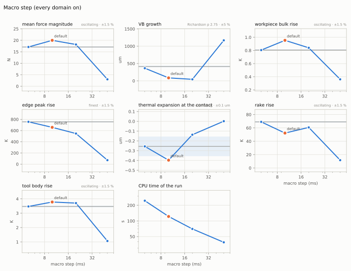

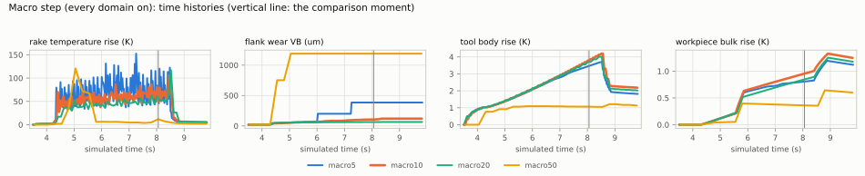

<!-- convergence:macro:begin -->
Case: a side step 0.5 mm wide and 1 mm deep along the front face of a 150 x 20 x 15 mm Al 6061-T6 block, x = -8 to
110 mm (4.4 s in cut), D10 4FL, 10 000 rpm, f_z 0.04 mm, flood coolant, every domain on; structure at 3000 DOF;
quantities when the tip passes x = 100 mm, forces over x = 20-100 mm.

| level | macro step (ms) | mean force magnitude (N) | VB growth (um) | workpiece bulk rise (K) | edge peak rise (K) | edge peak rise, 0.5 s mean (K) | thermal expansion at the contact (um) | preheat rise (material entering the cut) (K) | preheat rise, 0.5 s mean (K) | rake rise (K) | rake rise, 0.5 s mean (K) | tool body rise (K) | CPU s | in cut |
|---|---|---|---|---|---|---|---|---|---|---|---|---|---|---|
| macro50 | 50.00 | 11.03 | 0.8062 | 1.006 | 376.8 | 374.8 | 8.949e-04 | 18.35 | 18.41 | 31.77 | 32.85 | 2.248 | 60.4 | - |
| macro20 | 20.00 | 12.85 | 0.4620 | 0.8557 | 381.6 | 380.2 | -0.1051 | 18.05 | 17.99 | 30.71 | 31.24 | 2.261 | 101 | - |
| macro10 (default) | 10.00 | 13.07 | 0.09601 | 0.8059 | 378.4 | 370.7 | -0.3184 | 18.07 | 17.93 | 30.54 | 32.03 | 2.205 | 185 | - |
| macro5 | 5.000 | 13.18 | 0.04660 | 0.8308 | 374.5 | 363.9 | -0.3039 | 17.74 | 18.16 | 31.22 | 32.10 | 2.194 | 296 | - |
| macro2 | 2.000 | - | - | - | - | - | - | - | - | - | - | - | 600 | - |

| quantity | reference | how | observed order | default error | tolerance | default |
|---|---|---|---|---|---|---|
| mean force magnitude | 13.27 N | Richardson (3 finest) | 1.08 | 1.49 % | 1.5 % | inside |
| VB growth | 0.03888 um | Richardson (3 finest) | 2.89 | 123 % | 5 % | outside: no measured level converged |
| workpiece bulk rise | 0.8308 K | finest (oscillating) | (1.00) | 2.99 % | 1.5 % | outside: no measured level converged |
| edge peak rise | 374.5 K | finest level | (0.291) | 1.05 % | 1.5 % | inside (reference uncertain) |
| edge peak rise, 0.5 s mean | 347.9 K | Richardson (3 finest) | 0.503 | 6.27 % | 1.5 % | outside: no measured level converged |
| thermal expansion at the contact | -0.3039 um | finest (oscillating) | (3.89) | 0.0144 um | 0.1 um | inside (reference uncertain) |
| preheat rise (material entering the cut) | 17.74 K | finest (oscillating) | (3.81) | 1.88 % | 1.5 % | outside: no measured level converged |
| preheat rise, 0.5 s mean | 18.16 K | finest (oscillating) | (1.81) | 1.27 % | 1.5 % | inside |
| rake rise | 31.22 K | finest (oscillating) | (2.01) | 2.16 % | 1.5 % | outside: no measured level converged |
| rake rise, 0.5 s mean | 32.11 K | Richardson (3 finest) | 3.59 | 0.224 % | 1.5 % | inside |
| tool body rise | 2.192 K | Richardson (3 finest) | 2.46 | 0.569 % | 1.5 % | inside |

Observed orders in parentheses are those of the three finest levels where they are not used (not monotone, or
outside 0.5-4). "in cut": CPU seconds of the macro steps with the tool in the cut.
<!-- convergence:macro:end -->

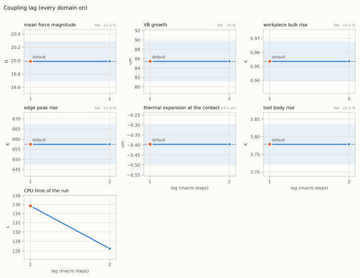

<!-- convergence:lag:begin -->
Case: the macro-step case (a side step 0.5 mm wide and 1 mm deep along the front face of a 150 x 20 x 15 mm Al
6061-T6 block, x = -8 to 110 mm (4.4 s in cut), D10 4FL, 10 000 rpm, f_z 0.04 mm, flood coolant, every domain on;
structure at 3000 DOF; quantities when the tip passes x = 100 mm, forces over x = 20-100 mm) at the default macro
step.

| level | lag (macro steps) | mean force magnitude (N) | VB growth (um) | workpiece bulk rise (K) | edge peak rise (K) | thermal expansion at the contact (um) | tool body rise (K) | CPU s | in cut |
|---|---|---|---|---|---|---|---|---|---|
| lag2 | 2.000 | 19.99 | 85.43 | 0.9536 | 657.4 | -0.3966 | 3.778 | 126 | - |
| lag1 (default) | 1.000 | 19.99 | 85.43 | 0.9536 | 657.4 | -0.3966 | 3.778 | 136 | - |

| quantity | reference | how | observed order | default error | tolerance | default |
|---|---|---|---|---|---|---|
| mean force magnitude | 19.99 N | all levels agree | - | 0 % | 1.5 % | inside |
| VB growth | 85.43 um | all levels agree | - | 0 % | 5 % | inside |
| workpiece bulk rise | 0.9536 K | all levels agree | - | 0 % | 1.5 % | inside |
| edge peak rise | 657.4 K | all levels agree | - | 0 % | 1.5 % | inside |
| thermal expansion at the contact | -0.3966 um | all levels agree | - | 0 um | 0.1 um | inside |
| tool body rise | 3.778 K | all levels agree | - | 0 % | 1.5 % | inside |

Observed orders in parentheses are those of the three finest levels where they are not used (not monotone, or
outside 0.5-4). "in cut": CPU seconds of the macro steps with the tool in the cut.
<!-- convergence:lag:end -->

**Lag: the two settings are the same computation.** lag_macro 1 and 2 give bit-identical runs (the digest of every
observed step value agrees), as the loop documents (the lag table was measured before the fixes of section 9 items 8
and 9; the two levels are the same run by construction). **Macro step, before those fixes (the copy of 14:28): not
converged, and not convergent in the present coupling.** The rake temperature cutting's coefficients read differed
from the first second of the cut on (85, 55 and 37 K at 4.8 s; it alternated from step to step, by +-50 K at 5 ms),
the flank wear followed it (VB 365, 85 and 44 um at 5, 10 and 20 ms at the comparison moment; 50 ms lost its tool at
the entry, VB 20 -> 752 um within 0.15 s), and the forces the wear (17.1, 20.0, 18.2 N); 2 ms ran out of bin/tsafe's
1.8 GB (section 9 item 10, fixed since).

**Macro step after the fixes of section 9 items 8 and 9 (re-measured 2026-11-09 in the `coupling` worktree; the table
above).** No level loses its tool, and the tool state no longer depends on the step: tool body rise 2.19-2.26 K,
edge peak rise 374-382 K, VB growth below 1 um at every level (0.05, 0.10, 0.46, 0.81 um at 5, 10, 20, 50 ms: the
flank now gets Blok's share of its contact heat, and the land barely wears in 3.6 s). The rake temperature cutting
reads is 31.2, 30.5, 30.7, 31.8 K at the comparison moment; from step to step it scatters by +-1-2 K at every level
(the teeth's heat from pass to pass, the cutting-region field's solves every 100 ms), so the default's value at that
instant is 2.2 % from the 5 ms one, outside the 1.5 % tolerance, while its mean over the last 0.5 s (32.10, 32.03,
31.24, 32.85 K) is 0.2 % from the Richardson value: inside. The preheat behaves alike (17.7-18.4 K; the instant 1.9 %,
the 0.5 s mean 1.3 %, inside). The mean force is at the tolerance (13.18, 13.07, 12.85, 11.03 N; 1.49 % from the
Richardson value). Outside: VB growth (a quantity near zero now, whose relative comparison is the wear model's floor),
the workpiece's bulk rise (0.83, 0.81, 0.86, 1.01 K: thermal's finite volumes run every 5 macro steps, 25-250 ms) and
the edge peak's 0.5 s mean (364, 371, 380 K at 5, 10, 20 ms, Richardson 348 K, 6 %: over 5.0-7.5 s the three agree
within 1 %, in the last half second the 20 ms run's hottest element ran hotter). The expansion at the contact is
inside at 10 ms (0.014 um from 5 ms) but structure's refresh is counted in macro steps (every 50, latency 50), so at
20 and 50 ms it lags: -0.11 and 0.00 um. The energy balance closes at every level (worst interval 3e-12 of its
terms). CPU: 296, 185, 101, 61 s at 5, 10, 20, 50 ms. **2 ms** (600 s, within the memory cap since section 9 item 10)
is left out of the analysis: its edge chipped at 7.90 s (one Weibull chipping trial of the wear model, VB +56 um;
no other level chipped), 0.19 s before the comparison moment, so its values there describe another edge (kept in the
results file as `details.quantities_excluded`: tool body 2.20 K, rake 32.7 K and its 0.5 s mean 32.5 K, edge peak
361 K, preheat 17.1 K, mean force 13.28 N). Before the event its tool body and rake temperature follow the 5 ms run
(rake over 6.0-6.5 s 29.1 against 29.1 K), but its preheat runs 3-8 % below it (16.8-17.2 against 17.7-18.3 K over
5.0-6.5 s); not explained (candidates: the step's work-heat share, the partition tables being read at each element's
in-cut chip thickness of the step, which at 2 ms is more often that of part of a pass; removal's engaged arc and depth
of the step).

## 6. Workpiece thermal grid (`physics.thermal.cell_mm`, `physics.thermal.every_n_macro`)

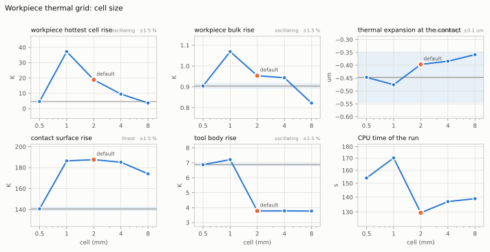

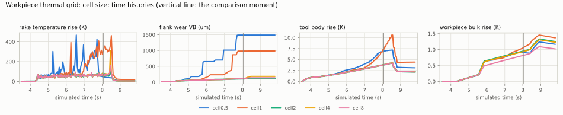

<!-- convergence:thermal_cell:begin -->
Case: the macro-step case (a side step 0.5 mm wide and 1 mm deep along the front face of a 150 x 20 x 15 mm Al
6061-T6 block, x = -8 to 110 mm (4.4 s in cut), D10 4FL, 10 000 rpm, f_z 0.04 mm, flood coolant, every domain on;
structure at 3000 DOF; quantities when the tip passes x = 100 mm, forces over x = 20-100 mm) at the default macro
step.

| level | cell (mm) | VB growth (um) | workpiece hottest cell rise (K) | workpiece bulk rise (K) | thermal expansion at the contact (um) | preheat rise (material entering the cut) (K) | preheat rise, 0.5 s mean (K) | rake rise, 0.5 s mean (K) | contact surface rise (K) | tool body rise (K) | CPU s | in cut |
|---|---|---|---|---|---|---|---|---|---|---|---|---|
| cell8 | 8.000 | 0.09601 | 2.838 | 0.6902 | -0.2948 | 18.13 | 17.94 | 32.03 | 244.4 | 2.205 | 167 | - |
| cell4 | 4.000 | 0.09601 | 6.822 | 0.7945 | -0.3085 | 18.13 | 17.99 | 32.03 | 247.8 | 2.205 | 167 | - |
| cell2 (default) | 2.000 | 0.09601 | 13.68 | 0.8059 | -0.3184 | 18.07 | 17.93 | 32.03 | 255.3 | 2.205 | 185 | - |
| cell1 | 1.000 | 0.09601 | 19.95 | 0.8033 | -0.3094 | 18.07 | 17.92 | 32.03 | 261.5 | 2.205 | 166 | - |
| cell0.5 | 0.5000 | 0.09601 | 23.63 | 0.7994 | -0.3068 | 18.05 | 17.91 | 32.03 | 260.2 | 2.205 | 185 | - |

| quantity | reference | how | observed order | default error | tolerance | default |
|---|---|---|---|---|---|---|
| VB growth | 0.09601 um | all levels agree | - | 3.95e-07 % | 5 % | inside |
| workpiece hottest cell rise | 28.83 K | Richardson (3 finest) | 0.771 | 64.1 % | 1.5 % | outside: no measured level converged |
| workpiece bulk rise | 0.7907 K | Richardson (3 finest) | 0.528 | 1.9 % | 1.5 % | outside: use 0.5 |
| thermal expansion at the contact | -0.3057 um | Richardson (3 finest) | 1.78 | 0.0127 um | 0.1 um | inside |
| preheat rise (material entering the cut) | 18.04 K | Richardson (3 finest) | 0.683 | 0.212 % | 1.5 % | inside |
| preheat rise, 0.5 s mean | 17.90 K | Richardson (3 finest) | 1.91 | 0.115 % | 1.5 % | inside |
| rake rise, 0.5 s mean | 32.03 K | all levels agree | - | 3.35e-08 % | 1.5 % | inside |
| contact surface rise | 260.2 K | finest (oscillating) | (2.18) | 1.88 % | 1.5 % | outside: use 1 |
| tool body rise | 2.205 K | all levels agree | - | 2.77e-07 % | 1.5 % | inside |

Observed orders in parentheses are those of the three finest levels where they are not used (not monotone, or
outside 0.5-4). "in cut": CPU seconds of the macro steps with the tool in the cut.
<!-- convergence:thermal_cell:end -->

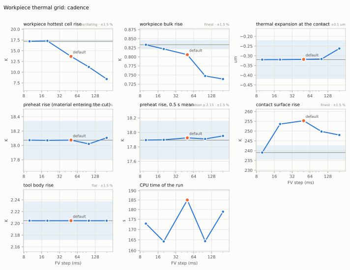

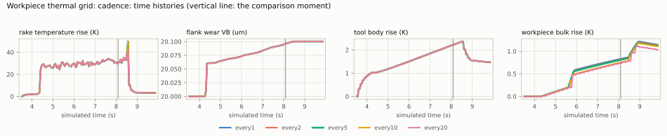

<!-- convergence:thermal_every:begin -->
Case: the macro-step case (a side step 0.5 mm wide and 1 mm deep along the front face of a 150 x 20 x 15 mm Al
6061-T6 block, x = -8 to 110 mm (4.4 s in cut), D10 4FL, 10 000 rpm, f_z 0.04 mm, flood coolant, every domain on;
structure at 3000 DOF; quantities when the tip passes x = 100 mm, forces over x = 20-100 mm) at the default macro
step (10 ms): the finite-volume step is every_n_macro x 10 ms.

| level | FV step (ms) | workpiece hottest cell rise (K) | workpiece bulk rise (K) | thermal expansion at the contact (um) | preheat rise (material entering the cut) (K) | preheat rise, 0.5 s mean (K) | contact surface rise (K) | tool body rise (K) | CPU s | in cut |
|---|---|---|---|---|---|---|---|---|---|---|
| every20 | 200.0 | 8.408 | 0.7389 | -0.2626 | 18.11 | 17.95 | 248.0 | 2.205 | 179 | - |
| every10 | 100.0 | 11.21 | 0.7475 | -0.3167 | 18.02 | 17.91 | 249.8 | 2.205 | 164 | - |
| every5 (default) | 50.00 | 13.68 | 0.8059 | -0.3184 | 18.07 | 17.93 | 255.3 | 2.205 | 185 | - |
| every2 | 20.00 | 17.27 | 0.8217 | -0.3196 | 18.07 | 17.90 | 253.6 | 2.205 | 164 | - |
| every1 | 10.00 | 17.19 | 0.8333 | -0.3197 | 18.07 | 17.89 | 239.0 | 2.205 | 173 | - |

| quantity | reference | how | observed order | default error | tolerance | default |
|---|---|---|---|---|---|---|
| workpiece hottest cell rise | 17.19 K | finest (oscillating) | (4.18) | 20.4 % | 1.5 % | outside: use 20 |
| workpiece bulk rise | 0.8333 K | finest level | (0.0406) | 3.29 % | 1.5 % | outside: use 20 |
| thermal expansion at the contact | -0.3197 um | finest level | (2.73) | 0.00134 um | 0.1 um | inside |
| preheat rise (material entering the cut) | 18.07 K | finest (oscillating) | (0.176) | 0.00256 % | 1.5 % | inside |
| preheat rise, 0.5 s mean | 17.89 K | Richardson (3 finest) | 2.13 | 0.179 % | 1.5 % | inside |
| contact surface rise | 239.0 K | finest level | (4.63) | 6.8 % | 1.5 % | outside: no measured level converged |
| tool body rise | 2.205 K | all levels agree | - | 2.16e-07 % | 1.5 % | inside |

Observed orders in parentheses are those of the three finest levels where they are not used (not monotone, or
outside 0.5-4). "in cut": CPU seconds of the macro steps with the tool in the cut.
<!-- convergence:thermal_every:end -->

Same case, 10 ms macro step, re-measured 2026-11-09 after the fixes of section 9 items 8 and 9 (the tables above;
the earlier runs below for the record). **Cell size.** The tool's state is the same at every cell from 8 to 0.5 mm to
six digits (tool body rise 2.2045 K, edge peak 378.43 K, rake 30.544 K, VB growth 0.0960 um, mean force 13.0716 N):
the preheat the coefficient rows read is now the material entering the cut at the leading edge of the contact's
moving source, the grid's value one tool diameter ahead plus the source's near field analytically (thermal section
3.3), 18.13, 18.13, 18.07, 18.07, 18.05 K from 8 to 0.5 mm (the default 0.2 % from the Richardson value, inside; its
0.5 s mean 0.1 %), and it moves by less than the rows' 5 K quantum. The workpiece's bulk rise converges from 4 mm
(0.690, 0.795, 0.806, 0.803, 0.799 K; the default 1.9 % from the Richardson value of the three finest, outside the
1.5 %); the hottest cell (2.8, 6.8, 13.7, 20.0, 23.6 K) is a quantity of the grid, the largest cell mean under a
moving source a fraction of a millimetre wide; the two-scale contact surface rise oscillates by +-2 % (244-262 K);
the thermal expansion at the contact is inside at every level (-0.29 to -0.32 um). **Cadence.** From every 20 to
every macro step the tool's state is again the same to six digits and the preheat within 0.5 % (its 0.5 s mean
within 0.3 %); the expansion is inside; the bulk rise (0.739, 0.747, 0.806, 0.822, 0.833 K) and the contact surface
(239-255 K) still move with the finite-volume step (3.3 % and 6.8 % from the every-step level at the default). The
defaults are inside for everything the coupled tool reads; the workpiece's own bulk, hottest-cell and surface values
remain outside.

Before the fixes (the copy of 14:28): the hottest cell doubled with every halving (3.6, 9.5, 18.8, 37 K from 8 to
1 mm), the bulk rise moved by +-12 %, and at 1 mm and 0.5 mm cells the tool's wear and temperature ran away about two
seconds earlier than at 8 to 2 mm (VB 963 and 1468 um at the comparison moment against 85-94 um, the tool body twice as
warm), because the preheat was the cell one feed half length plus one cell ahead, inside the moving source's near
field, which the rows picked up once it crossed their temperature tolerance; at every 2 steps the cadence started the
runaway through the same preheat (VB 195 um).

## 7. Turning: polar field (`physics.polar_theta_bins`, `physics.removal.polar_min_feed_mm_rev`)

The polar field of a turned workpiece (removal section 11) has `polar_theta_bins` bins in angle and rows of height
dz = min(f_min / 8, r_nose / 16), f_min being `physics.removal.polar_min_feed_mm_rev` (default 0.05 mm: 6.25 um for
the 0.8 mm nose); it carries the earlier revolutions' surface every chip is read from, and the turned profile (Ra,
Rt). Case: an OD pass on a 4140 bar d45 x 40 mm (CNMG120408 in PCLNR, 1400 rpm, f 0.25 mm/rev, ap 1.5 mm, rigid), 5
mm long; the profile over its steady 2.5 mm. The rows of the theta study are 25 um; `polar_max_mb` is raised to 400
so that no level is coarsened.

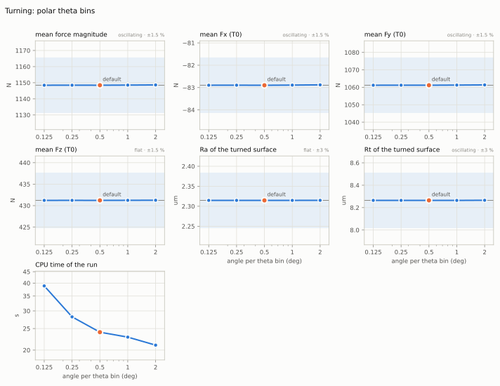

<!-- convergence:turn_theta:begin -->
Case: OD pass, 4140 d45, CNMG120408 / PCLNR, 1400 rpm, f 0.25 mm/rev, ap 1.5 mm, rigid; rows 25 um
(polar_min_feed_mm_rev 0.2), polar_max_mb 400 (no coarsening).

| level | angle per theta bin (deg) | mean force magnitude (N) | mean Fx (T0) (N) | mean Fy (T0) (N) | mean Fz (T0) (N) | Ra of the turned surface (um) | Rt of the turned surface (um) | CPU s | in cut |
|---|---|---|---|---|---|---|---|---|---|
| th180 | 2.000 | 1149 | -82.88 | 1061 | 431.3 | 2.315 | 8.266 | 21.1 | 2.63 |
| th360 | 1.000 | 1149 | -82.89 | 1061 | 431.2 | 2.315 | 8.264 | 22.9 | 3.24 |
| th720 (default) | 0.5000 | 1148 | -82.90 | 1061 | 431.2 | 2.315 | 8.265 | 24.1 | 3.85 |
| th1440 | 0.2500 | 1148 | -82.89 | 1061 | 431.2 | 2.315 | 8.265 | 28.2 | 6.28 |
| th2880 | 0.1250 | 1148 | -82.90 | 1061 | 431.2 | 2.315 | 8.265 | 38.9 | 14.4 |

| quantity | reference | how | observed order | default error | tolerance | default |
|---|---|---|---|---|---|---|
| mean force magnitude | 1148 N | finest (oscillating) | (0.00428) | 3.31e-06 % | 1.5 % | inside |
| mean Fx (T0) | -82.90 N | finest (oscillating) | (1.15) | 0.00241 % | 1.5 % | inside |
| mean Fy (T0) | 1061 N | finest (oscillating) | (0.0211) | 1.78e-05 % | 1.5 % | inside |
| mean Fz (T0) | 431.2 N | all levels agree | - | 0.00022 % | 1.5 % | inside |
| Ra of the turned surface | 2.315 um | all levels agree | - | 8.07e-05 % | 3 % | inside |
| Rt of the turned surface | 8.265 um | finest (oscillating) | (0.884) | 0.000381 % | 3 % | inside |

Observed orders in parentheses are those of the three finest levels where they are not used (not monotone, or
outside 0.5-4). "in cut": CPU seconds of the macro steps with the tool in the cut.
<!-- convergence:turn_theta:end -->

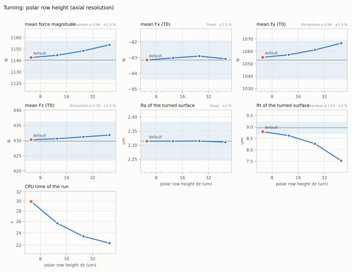

<!-- convergence:turn_dz:begin -->
Case: OD pass, 4140 d45, CNMG120408 / PCLNR, 1400 rpm, f 0.25 mm/rev, ap 1.5 mm, rigid, 720 theta bins; dz =
min(f_min / 8, r_nose / 16) with f_min = polar_min_feed_mm_rev (the default 0.05 mm gives 6.25 um), polar_max_mb 400
(no coarsening).

| level | polar row height dz (um) | mean force magnitude (N) | mean Fx (T0) (N) | mean Fy (T0) (N) | mean Fz (T0) (N) | Ra of the turned surface (um) | Rt of the turned surface (um) | CPU s | in cut |
|---|---|---|---|---|---|---|---|---|---|
| fmin0.4 | 50.00 | 1154 | -83.08 | 1067 | 431.8 | 2.311 | 7.524 | 22.3 | 3.32 |
| fmin0.2 | 25.00 | 1148 | -82.90 | 1061 | 431.2 | 2.315 | 8.265 | 23.4 | 3.70 |
| fmin0.1 | 12.50 | 1145 | -83.02 | 1057 | 430.6 | 2.314 | 8.621 | 25.7 | 4.52 |
| fmin0.05 (default) | 6.250 | 1143 | -83.15 | 1055 | 430.3 | 2.314 | 8.795 | 29.9 | 6.11 |
| fmin0.025 | 3.125 | - | - | - | - | - | - | failed: AssertionError: workpiece 0: removed volume 8.470526310494712e-07 m3 booked, fie | - |

| quantity | reference | how | observed order | default error | tolerance | default |
|---|---|---|---|---|---|---|
| mean force magnitude | 1140 N | Richardson (3 finest) | 0.938 | 0.193 % | 1.5 % | inside |
| mean Fx (T0) | -83.15 N | finest level | (0.185) | 0 % | 1.5 % | inside |
| mean Fy (T0) | 1053 N | Richardson (3 finest) | 0.943 | 0.211 % | 1.5 % | inside |
| mean Fz (T0) | 429.8 N | Richardson (3 finest) | 0.784 | 0.112 % | 1.5 % | inside |
| Ra of the turned surface | 2.314 um | finest level | (3.60) | 0 % | 3 % | inside |
| Rt of the turned surface | 8.964 um | Richardson (3 finest) | 1.03 | 1.92 % | 3 % | inside |

Observed orders in parentheses are those of the three finest levels where they are not used (not monotone, or
outside 0.5-4). "in cut": CPU seconds of the macro steps with the tool in the cut.
<!-- convergence:turn_dz:end -->

**Theta bins: converged at every level, inside.** From 180 to 2880 bins the forces agree to 0.02 % and Ra, Rt to
0.01 %: every bin is cut at its centre angle with the tool at that angle's position, so the helical feed marks are
exact at any bin count, and cutting reads the chip at the nearest bin of a surface that changes by f / n_theta per
bin (0.35 um at 720 bins). 360 bins would do for a steady pass (0.8 times the CPU in cut); threading and interrupted
cuts were not studied. **Row height: inside.** The forces converge at first order (p 0.94; the default is 0.19 %
above the Richardson value), because an element reads the radius of the nearest row; Ra is flat (2.314 um); Rt
converges at first order (p 1.03; the cusp tips fall between row centres, so the sampled peak-to-valley misses up to
the profile's slope times dz / 2): the default is 1.9 % below the Richardson value 8.96 um, inside the 3 %
tolerance. (The simulated Ra and Rt lie below the nose-radius values f^2 / (18 sqrt 3 r) = 2.52 um and r - sqrt(r^2
- f^2 / 4) = 9.83 um because the insert's trailing edge, 5 deg behind the nose, cuts the cusp; the rigid model
reproduces the kinematic profile.) The finer level (dz 3.125 um, f_min 0.025 mm) stops at its first cut: removal's
polar volume, the int64 sum of q_hi^2 - q_lo^2 over all radial rays (`k_polar.polar_q2_sum`), exceeds 2^63 for this
bar (720 x 12 800 rays of radii up to 2.25e6 quanta: about 4.7e19) and the driver's exact-volume check sees the
change wrap by 2^64 quanta (2.4e-5 m3); at 6.25 um the sum also exceeds 2^63, but the wrap happens not to fall
inside the pass (section 9).

## 8. Recommended defaults and their cost

No template value is changed here (docs/schema consistency is another task's); these are the defaults the studies
support, with the CPU time they cost on the cases above (CPU in cut, the share a level changes).

| setting | shipped | recommended | why | cost |
|---|---|---|---|---|
| `max_deg_per_step` | 0.5 | 0.125 where peak forces matter (tool breakage, deflection and holding margins); 0.5 otherwise | peak force 5-11 % low at 0.5 deg, within 2 % at 0.125 deg; every averaged quantity converged at 3 deg already | x2.5 (slot) and x2.2 (finish) CPU in cut (a 2 us stride at 10 000 rpm); none if cutting reports the instantaneous peak (section 9, 1) |
| `steps_per_tooth` | 96 | 96 | binds only above 7.5 teeth at 0.5 deg; the angle rule decides the end mills | - |
| `lattice_mm` | 0.25 | 0.25 for roughing; finishing passes under `twin check`'s ae / 4 (or a refine box), as now | the mean force and the analytic chip are inside from 0.125 mm on a 0.3 mm finish; the ledger's removed volume of a thin layer and the engaged arc do not converge with the lattice alone (section 9, 4) | x1.5 (finish) and x1.8 (corner) from 0.25 to 0.03125 mm, with 64 times the rays |
| `edge_element_mm` | 0.5 | a model change rather than a smaller default: the boundary element weighted by its engaged length (section 9, 2); without it, 0.0625 mm bounds the error to 0.025 mm / ap | the forces at a depth of cut err by up to half an element's height over ap (-4.8 % at ap 3 mm with 0.5 mm elements) | x4.4 for 0.0625 mm |
| `memory_bins` | 720 | 720 with 0.5 deg; never finer than 360 / angle per step | the averages are inside with the stride; finer bins alone add an error | - |
| `polar_theta_bins` | 720 | 720 (360 suffices for steady passes) | converged at 180 for an OD pass | x0.8 at 360 |
| `polar_min_feed_mm_rev` (rows) | 0.05 (6.25 um) | 0.05 | forces 0.2 % and Rt 1.9 % from the Richardson value | - |
| `macro_ipo` | 10 | 10 (20 for the tool and the coupling alone) | since the fixes of section 9 items 8-9 the tool state and the 0.5 s means of the coupling temperatures agree within 0.2-1.5 % from 5 to 20 ms; the workpiece's bulk (finite volumes every 5 steps) and structure's refresh (every 50) move with the step | 5 ms: x1.6 CPU, 20 ms: x0.55 |
| `lag_macro` | 1 | 1 (2 is the same computation) | bit-identical | - |
| `thermal.cell_mm` | 2 | 2 (4 for the coupled tool and the bulk mean) | since the preheat fix the tool's state is the same at every cell and the preheat within 0.5 %; the expansion is inside; the bulk mean converges from 4 mm (1.9 % from the Richardson value at 2 mm); hottest cell and surface stay grid-dependent | 1 and 0.5 mm: about the default's CPU (165-185 s) |
| `thermal.every_n_macro` | 5 | 5 | the tool's state and the preheat do not depend on it (every 20 to every step); the expansion is inside; the bulk mean is 3.3 % and the contact surface 6.8 % from the every-step level | - |

## 9. Found on the way (for the owners)

1. **Peak forces are step means** (cutting, hot loop). `CuttingContact.wrench_tool_T0_peak` keeps the largest L0
   sample of a tick, and an L0 sample is the force integrated over the step's swept angle divided by the step; the
   force jumps whenever an element enters the cut (its edge force; in climb milling its whole chip), so the peak is
   5-11 % low at the default stride (sections 1, 4.1) and converges only from 0.125 deg. Evaluating the elements at
   the step's ends as well (the largest of the two end forces and the mean) would give the peak without refining the
   stride.
2. **The element at the depth-of-cut line is engaged whole or not at all** (cutting, tooling). The engaged edge ends
   at the boundary of the top engaged element, so the forces, torque, heat and the analytic chip volume err by
   (engaged length - ap) / ap, up to half an element's axial height over ap: -4.8 % at ap 3 mm and -32 % at ap 0.6
   mm with the default 0.5 mm elements (sections 3, 4.1); scaled by that length every element size gives the same
   force to 0.05 %. Weighting that element by the engaged fraction of its length (the field's outer boundary along
   the edge, which the gating already samples) would remove the error at the default size. Until then removal's
   volume consistency (field against analytic chip volume, warned outside 2 %) measures the element size as much as
   the field, and the chips' mass scaling carries the difference.
3. **`edge_element_mm` above 0.76 mm (helical end mills) or 0.65 mm (ball noses) changes nothing**: tooling's
   `max_lag_step_deg` (5 deg) and `max_kappa_step_deg` (7.5 deg) bind first (section 3).
4. **The ledger's removed volume of a thin layer is first order in the lattice** (removal). The z family's columns
   stand at the nodes, so a finishing layer holds a whole number of node rows: -18 % at the template's 0.25 mm and
   +2.3 % at 0.03125 mm for ae 0.3 mm (section 2), up to a / (2 ae) in general; `twin check`'s ae / 4 rule bounds it
   at 12.5 %. The family normal to the cut surface is exact for it (on the corner the y family at 0.03125 mm was
   within 0.15 % of the swept volume); booking the removed volume from the family most normal to each removed piece,
   or reporting the spread of the three (`removed_volume_xyz_m3`) as the volume's uncertainty in the ledger, would
   make the mass balance exact for the material, not only for the field.
   fixed (twin check's side, 2026-11-09; the ledger's booking is removal's and open): the rule did not fire for the
   very pass of section 2.1. sanity's 0.5 mm height map gave the 12 mm block a 12.5 mm extent (a phantom row from
   round-off of 0.012 / cell, and partial cells counted as material) and the 0.3 mm pass an ae of 1.0 mm, exactly
   4 x 0.25 mm; refine boxes counted without checking that they cover the pass. `twin check` now re-runs the
   estimate on a map of lattice / 4 (sanity's map: material only where a cell centre is inside the stock) and warns
   once per finishing pass with its lines, ae, the lattice in force, the one the rule asks for, the refine factor and
   the error bound lattice / (2 ae) (docs/models/loop.md 9; tests/integration/test_check_rules.py).
5. **`memory_bins` finer than one bin per L0 step changes the result** (cutting): 2880 bins at 0.48 deg per step
   move the mean force by +1.5 % and the chip volume by +2.5 % against 1440 bins (section 4.2). The memory should be
   refined only with the stride (memory_bins <= 360 / angle per step); `twin check` could warn above it.
   fixed (2026-11-09): `twin check` gives every rotating tool's stride entry the spindle angle of an L0 step at the
   stride the run takes at the programmed speed (`angle_per_step_deg`) and the most bins it allows
   (`memory_bins_max`), and warns when `physics.memory_bins` exceeds it (the default 720 at 0.48 deg allows 750;
   2880 is warned; docs/models/loop.md 9, tests/integration/test_check_rules.py).
6. **The polar field's volume overflows int64** (removal, `k_polar.polar_q2_sum`): the sum of q_hi^2 - q_lo^2 over
   the radial rays exceeds 2^63 for a d45 x 40 mm bar at 720 bins and rows of 6.25 um or less; the volume difference
   the ledgers take is right only while the wrap does not fall between two checks, and at 3.125 um rows the driver's
   exact-volume check stopped the run (section 7). Summing per row in int64 and accumulating the rows in a wider
   integer (or Python int) would keep it exact.
7. **`lag_macro: 2` is computed as lag 1** (loop; docs/models/loop.md says so): the two give the same result here
   (section 5), and cutting's `coupling_lag` warning ("compare physics.lag_macro 1 and 2") asks for a comparison
   that cannot differ.
8. **The rake temperature cutting reads depends on the macro step** (thermal, cutting): 85, 55 and 37 K at 5, 10 and
   20 ms at the same moment of the same cut, and it alternates from step to step (+-50 K at 5 ms); the coefficient
   rows, the wear rates and the heat partition follow it (section 5). A coupling quantity computed from one step's
   heat and frozen for the next should not change with the step's length.
   fixed (2026-11-09, thermal; where cutting reads it): four inputs of the thermal -> cutting coupling were functions
   of the step. (1) The edge model rebuilt each element's periodic heating from the step's counts: the period as the
   step over its passes (5 ms at 5 ms steps, 5 or 10 ms at 10 ms, 5 or 6.7 ms at 20 ms, for a 6 ms revolution), and an
   element whose step held no pass (one 5 ms step in six) restarted and published its body temperature, with the
   cutting-region field its cycle mean, as its entry temperature: the alternation. Each element now keeps running
   sums of its passes in run time (heat, in-cut time, passes; `edge_window_periods` 4 revolutions), its period is the
   revolution and a step without a pass leaves it engaged (thermal.md 2.2). (2) The cutting-region field was solved
   every 10 macro steps (50, 100, 200 ms) and split between the teeth by the step's heat; it is now solved at fixed
   run times (`tool_field_interval_ms` 100) and split by the teeth's heat per in-cut time, and the edge is evaluated
   at fixed run times too (`edge_interval_ms` 20). (3) The rows read the plain mean over an edge group's members,
   dominated by the idle part of the flute (2 of 44 elements per tooth cut in this case); they read the members that
   cut, weighted by in-cut time summed over the teeth, and a rotating tool's contact time as the engaged arc over the
   spindle speed (cnctwin/cutting/domain.py `_row_state`). (4) The preheat's band carried the step's heat rate; it
   carries the rate averaged over the same revolutions (thermal.md 3.3). Unit test `tests/unit/thermal/
   test_edge_history.py` (a 6 ms revolution, 0.43 ms passes): entry rise 1.09, 1.09, 1.09 K at 5, 10, 20 ms (was
   1.04, 1.45, 1.45 K, the teeth 0-1.45 K), with the field 5.24, 5.25, 5.24 K (was 7.3, 8.2, 7.6 K, the teeth -2.4 to
   8.2 K). The macro-step study after the fix (section 5): the rake rise cutting reads 31.2, 30.5, 30.7, 31.8 K at 5,
   10, 20, 50 ms at the comparison moment (+-2 % step-to-step scatter at every level) and 32.10, 32.03, 31.24, 32.85 K
   as its 0.5 s mean (the default 0.2 % from the Richardson value); tool body 2.19-2.26 K, edge peak 374-382 K; no
   level loses its tool (50 ms did at the entry).
9. **The tool's wear and temperature run away in aluminium within seconds** (wear, thermal): the D10 side step (0.5
   x 1 mm at 10 000 rpm, flood) wears its flank from 20 to 106 um in 3.6 s of cutting and then runs away (592 um
   after 4.6 s, 1.2 mm at 14 s simulated, then no cut); VB rises in jumps (edge chipping), far faster than the tool
   lives of minutes to hours usual for carbide in 6061. The finer workpiece grid (1 mm) and cadence (every 2 steps)
   start the runaway earlier through the preheat (section 6), the macro step through the rake temperature (section
   5). The copy of 12:38 lost the tool at the first entry of every whole-loop run instead (VB 20 -> 1190 um within
   0.3 s).
   fixed (2026-11-09, wear; the flank temperature wear receives is thermal's and open): the runaway had one driver
   and two amplifiers. **Driver**: thermal's flank contact temperature, 673 K median over the engaged elements
   (590-730 K, up to 843 K; its quadrature maxima 935 K median, up to 1420 K, which wear takes at the alloy's 855 K
   solidus since the snapshot's contact-state bound), against 416 K median (338-438 K) that the wear law's own flank
   model (the calibration response: Blok's equal temperature of the land with its friction softened at the land's
   temperature) gives at the same elements (314 m/min, h_max 17 um, VB 20 um); the rake contact 664 against 461 K
   (Oxley's interface). The law of carbide in 6061 is calibrated on that model at the estimated Taylor entry's speeds
   (flank 569-598 K between v60 and v5): B = 21.6 kK, so the life halves per +5.6 K and the cutting time to VB 0.3 mm
   is 187 h at the model's flank, 81 h at +100 K, 32 min at +200 K, 17 s at +300 K and 0.5 s at +400 K
   (docs/models/wear.md 3, "Coupling to the run's flank temperature"); thermal's +250 K on the means and +436 K at
   the capped maxima wear the tool out in seconds; thermal's local rise halved (about 484 K, dT 65 K) would give some
   120 h. The flank temperature input must come within about 150 K of the law's model (thermal's fix of its flank
   heat, owner thermal/mechanics; or a response that is the run's pipeline) before a wear law calibrated this way
   gives physical lives here. **Whole loop after the fixes** (five such side steps, each 0.5 mm deeper, x -8 to 160
   mm: 29.1 s of cutting, 40.6 s simulated, every domain on; the wear domain given its own model's contact
   temperatures in place of thermal's, the substitution made in the test script, not in the code): VB 20.000 ->
   20.011 um (0.4 nm per second of cutting, the abrasive floor), crater 0.4 nm, no chip (the entry and exit loads'
   static chipping probability 3e-10 median, 4e-6 at most), thermal damage 3e-4. The same side step with thermal's
   own temperatures (one pass, 4.3 s of cutting): VB 20 -> 53 um after 0.5 s of cutting, 87 um after 1 s, 306 um
   after 2 s and 405 um after 3 s, crater 13 um, four elements chipped late by the exit loads of the worn edge
   (9.6-9.9 GPa wedge stress); thermal's flank 581 K median on the means of the engaged elements, at the 855 K
   solidus at its maxima. The snapshot before these fixes, run the same way: 60, 115, 384 and 395 um after 0.5, 1, 2
   and 3 s (a chip of 18 um at 2 s put 98 um on the land), five elements chipped, chips up to 51 um deep (the
   convergence copy of 14:28, before the solidus bound and later cutting changes: 46, 60, 72 and 95 um). **Amplifier
   1**: every chip added its depth times g = cot a - tan g (5.5 for this end mill) to VB, as if the depth were a
   recession normal to the machined surface; the fragment's lowest point lies d sin a above the old edge (Flamant:
   the fracture runs along the arc r = d), so a chip adds about d to a fresh land and nothing to a worn land it ends
   inside (`kernels.flank_recession`). **Amplifier 2**: each entry and exit row drew a new chipping trial, so that an
   edge loaded 167 times a second chipped in the end at any stress (1 - (1 - P)^N); the edge now has its own Weibull
   strength (one quantile per edge and chip generation) that its load cycles degrade along the tool material's
   Basquin curve (Miner, equal rank). Also fixed in wear's calibration: a life integral that one Gauss rule evaluated
   across the land's kinks (5-10 % on a Ti6Al4V life). Examined and not adopted: Blok's partition of the response
   without its clamp at f >= 0 (the small land's flank then sits at the shear-plane temperature, the work surface
   carrying no ploughing heat): B 43 kK for this law, and with thermal's temperatures kilometres of VB in the first
   step of the case (docs/models/wear.md 3).
   fixed (2026-11-09, the heat behind it; mechanics and thermal, the wear model is wear's): (1) the flank partition
   applied Blok's share of the land friction to the whole edge power over a different contact length, which put about
   twice Blok's contact temperature on the flank and raised it as the tool cooled (mechanics.md 6; validation.md 10,
   Coolant): the share is now computed for the contact's friction and the edge's plastic work over the contact the
   heat is deposited on. (2) The preheat was the cell one feed half length plus one cell ahead, inside the moving
   source's near field, so it doubled with each halving of the cell: it is now the grid's value one tool diameter
   ahead plus the source's near field put back analytically at the leading edge (thermal.md 3.3; unit test
   `tests/unit/thermal/test_preheat.py`: 14.08-14.10 K at cells of 4 to 0.5 mm where the cell ahead gave 1.5-6.2 K).
   (3) Item 8. On the macro-step case at 10 ms: VB growth 85 -> 0.10 um at the comparison moment, tool body rise
   3.78 -> 2.20 K, edge peak rise 657 -> 378 K, rake rise 52 -> 31 K, mean force 20.0 -> 13.1 N; at every macro step
   from 5 to 50 ms and every workpiece cell from 8 to 0.5 mm VB grows by less than 1 um over the 3.6 s, and the tool
   state does not depend on the cell at all (sections 5, 6); the 2 ms run lost 56 um of land in one Weibull chipping
   event at 7.90 s (wear's stochastic chipping trial, one realisation). The two-pass 11 s cut was not rerun.
10. **`macro_ipo` 2 exceeds bin/tsafe's 1.8 GB cap** about 26 s into the run, before the cut (both copies), where
    the 10 ms run of the same project completes under it: something held per macro step grows with their number.
    fixed (2026-11-09, motion and chips): nothing grew per step. RSS per macro step on an air-cut variant of the case
    (2 ms) stayed at 920-950 MB for 800 steps and then rose past the cap within one call of chips' `fill_occupancy`
    at the tool change: the tip moved to the new tool's point between two ticks (102 mm in 1 ms), motion booked that
    as the tick's feed velocity (102 m/s), and chips sized its frozen occupancy grid by the travel at it over the lag
    (+-0.41 m at 2 ms: 416 x 416 x 467 voxels, 1.9 GB). It reads the last tick of a step only: at 2 ms the jump fell
    on it, at 10 ms it did not (it would have spanned +-2 m). Motion now gives that tick the velocity of the tick
    before (the axes stand at a tool change), and chips bounds the sweep by the machine's top tool speed
    (`scene.tool_speed_max`, 1.03 m/s for the VF-2SS). After the fix: 2500 steps at 2 ms through the tool change,
    RSS 944-983 MB, trend -13.5 kB per step (docs/models/loop.md 15; tests/integration/test_loop_memory.py,
    tests/unit/motion/test_timing.py `test_a_tool_change_is_no_feed_motion`, tests/unit/chips/test_recut.py).
11. **The control rounds an internal corner by up to 0.45 mm** at 1600 mm/min (the pocket corner of section 2.2, a
    sharp programmed turn): the volume the tool removes is 7.6 % less than the programmed path's. This is the
    control model (look-ahead and corner blending), not an error, but it makes the programmed path a wrong reference
    for removal.
    fixed (2026-11-09, motion and the Haas and SINUMERIK dialects): measured on that corner (motion alone), the
    commanded path passed it at 0.635 mm (a 1.533 mm blend radius) and the tool at 0.646 mm. The tolerance in force is
    the VF-2SS's Setting 85, 0.0250 in = 0.635 mm (db/machines/haas-vf2ss.yaml `smoothing`, haas-ngc-mill-om-2020 p.
    456), which Haas documents as the largest corner radius ("the control keeps the radii of corners no bigger than"
    it and adjusts the feed at corners to meet it), while motion took every control's tolerance as the deviation
    from the corner: 2.4 x the documented radius at a square corner, at any feed. Haas's Setting 85 and G187 E are
    now a radius: the corner is rounded as far as the axes need at the feed (here R 0.436 mm: commanded deviation
    0.181 mm, tool 0.193 mm, no slow-down), up to the setting, the corner slowing where the feed needs more;
    SINUMERIK's G641 ADIS likewise became the rounding distance it is. Heidenhain cycle 32 T, CYCLE832 S_TOL / G642
    and FANUC's smoothing tolerance are deviations by their documentation and stay so (docs/models/motion.md 2.2).
    The swept-volume reference of section 2.2 (the path the tool took) is unaffected; the tables above were measured
    before this change.

## 10. Reproducing

```
bin/tsafe python tools/convergence/warm.py [--root DIR]          # compile a frozen copy's kernels (12-14 CPU min)
tools/convergence/run_all.sh [--root DIR] [--fresh] [study ...]   # the studies, then the curves and these tables
bin/tsafe python tools/convergence/study.py --list                # the studies and their levels
bin/tsafe python tools/convergence/study.py <study> --analyse     # re-analyse stored results (no simulation)
TSAFE_MEM=1800M bin/test --all convergence                        # the tests (slow; the whole-loop runs need 1.8 GB)
```

**Tests.** `tests/convergence/test_convergence.py` runs, per study, the shipped default and the finer levels its
reference rests on, and asserts the verdicts of this document on the tree it runs in: the quantities recorded as
inside must stay inside; those recorded as outside are asserted by a strict expected failure per study (it fails, as
XPASS, once the default comes inside). On the working tree of 2026-11-09 16:00-17:00 (other work had changed cutting,
removal, wear, thermal and the loop since the copy) the suite took 2016 CPU s; two verdicts that sat at their tolerance
on the copy came out on the other side there (the side finish's mean force against the lattice, 1.50 % on the copy and
1.59 % on the working tree, and the thermal cell study's expansion, whose 0.5 mm level moved from -0.45 to -0.16 um),
and both are recorded as outside; with that, 14 tests pass and 9 fail as expected.

`--root DIR` runs a copy of the tree (cnctwin/, db/, examples/, validation/) with its own Numba cache
(`tools/convergence/env.py`): bin/tsafe keys the working tree's cache by every kernel source, so while other work
edits kernel files every run of the working tree starts with a cold compile. Results go to
`tools/convergence/results/` (one JSON per study: levels, settings, quantities, details, cost, analysis), curves to
`docs/img/convergence/` (SVG with fixed metadata), tables into this file (`tools/convergence/report.py`). The same
tree gives the same results: the simulator is deterministic and no wall-clock value enters a result (CPU times are
reported, not compared).
